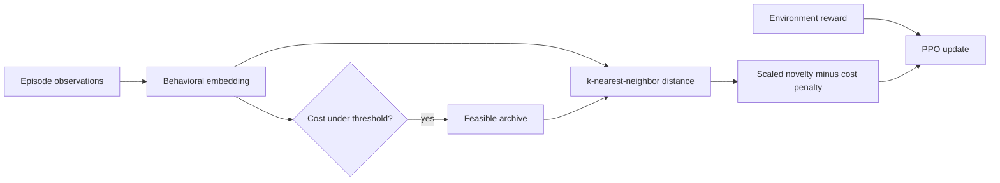

<div align="center">

# Boundary-Aware Novelty Search for Sparse-Reward Reinforcement Learning

**Exploring when behavioral novelty helps reinforcement learning — and how feasibility-aware novelty shaping can improve sparse-reward exploration.**

Sparse-reward tasks give the agent almost no learning signal until a goal is reached. This project asks whether exploration should chase prediction error in the observation, or novelty of the whole trajectory — and whether that novelty should be restricted to trajectories that remain feasible.

Five PPO agents are compared on MiniGrid-DoorKey-5×5 and Procgen-Maze. The proposed variant, Boundary-Aware Novelty Search (B-NS), keeps an archive of feasible trajectories and subtracts a cost penalty from the novelty bonus.

<p>
  
  
  
  
  
</p>

</div>

---

## Research question

**How can we make exploration more effective in sparse-reward reinforcement learning, and when does trajectory-level novelty provide an advantage over prediction-error-based curiosity?**

<table>
<tr>
<td align="center" width="25%"><b>Sparse rewards</b><br>The environment is silent until the goal.</td>
<td align="center" width="25%"><b>Intrinsic motivation</b><br>An extra reward is added so PPO can learn before the first success.</td>
<td align="center" width="25%"><b>Novelty search</b><br>The bonus depends on how unusual the whole trajectory is.</td>
<td align="center" width="25%"><b>Boundary-aware exploration</b><br>Only feasible trajectories define what counts as novel.</td>
</tr>
</table>

Prediction-error curiosity (ICM, RND) pays the agent for transitions the model does not yet predict. Trajectory-level novelty (NS, B-NS) pays for behavior whose embedding is far from an archive of past episodes. B-NS changes the archive, not the policy optimizer: neighbors are taken from trajectories whose cost stays under a threshold, and a penalty term pushes cost back down.

---

## Three findings

Each curve is one training run. Plots titled “total reward” are the running sum of the reward used in training. On Procgen-Maze the environment itself pays 0 or 10, so a curve on the order of 10<sup>6</sup> is dominated by the intrinsic term.

### 1. When does novelty help?

On the shorter MiniGrid comparison, prediction-error bonuses pull away and both novelty methods stay near zero. On the 200,000-step novelty runs, NS and B-NS both accumulate reward, and B-NS finishes slightly ahead.

<table>
<tr>
<td width="50%" valign="top">


*MiniGrid-DoorKey-5×5, shorter run. ICM finishes highest, then RND, then PPO. NS and B-NS stay flat.*

</td>
<td width="50%" valign="top">


*Same environment, 200,000-step novelty runs. Both curves rise. B-NS starts later and ends just above NS.*

</td>
</tr>
</table>

> **Takeaway.** Trajectory-level novelty is sensitive to the environment and the training budget. The short MiniGrid run favors ICM and RND. The longer novelty runs do collect reward, but this plot does not include PPO, ICM, or RND.

### 2. Can novelty search be structured?

Standard NS rewards a trajectory for being far from everything stored so far. B-NS keeps neighbors only from the feasible archive and subtracts a cost penalty. Those two changes were used together, so this plot does not separate them.


*Procgen-Maze. Cumulative training reward: B-NS ends above NS, and crosses RND late in the run. PPO stays near zero and ICM rises slowly. Because the vertical axis is about 10<sup>6</sup>, this is not a count of solved mazes.*

> **Takeaway.** In this Procgen run, feasibility-aware novelty shaping produced a larger cumulative training return than standard NS. That return is mostly the intrinsic bonus.

### 3. How large should the novelty bonus be?

On Procgen-Maze, B-NS was run at β = 5 and β = 20. The larger coefficient produces a much larger cumulative training return. It is a better setting for that summed curve, not a universal optimum.


*B-NS on Procgen-Maze. β = 20 accounts for almost the entire cumulative gap. β = 5 stays near the axis.*

> **Takeaway.** The novelty coefficient has to be large enough to move the training signal. β = 20 does that here. The same plot does not show that the larger bonus solved more mazes.

---

## Method

B-NS leaves PPO fixed and replaces the intrinsic term.



1. **Embed the trajectory.** A frozen random convolutional network maps observations to features. The episode vector is their average, L2-normalized. For B-NS, the average is taken over frames whose pixel change exceeds a threshold; if none do, the full episode is used.
2. **Keep a feasible archive.** An episode enters the neighbor set only when its accumulated cost stays within a threshold.
3. **Score novelty.** Novelty is the mean Euclidean distance to the *k* nearest archived embeddings (*k* = 10), then rescaled with a median and interquartile range.
4. **Charge for cost.** A cost term penalizes repetitive or visually blocked behavior. Its weight λ increases when recent episode cost sits above the threshold, and is clipped at zero.
5. **Train PPO.** The shaped term is added to the environment reward and the policy is updated with PPO. In the Stable-Baselines3 runs, that term is applied at the end of the episode and multiplied by episode length.

ICM and RND use the same PPO optimizer. Their bonus is a per-step prediction error: a forward model for ICM, a fixed random network for RND.

---

## Experimental setup

| | MiniGrid-DoorKey-5×5 | Procgen-Maze |
|---|---|---|
| What is hard | Pick up a key, open a door, reach the goal. External reward is sparse. | Reach the maze exit. External reward is sparse. |
| Observation in the NS / B-NS runs | Fully observed RGB, resized to 64×64 | Native 64×64 RGB |
| Levels | One fixed layout | 200 levels, `easy` distribution, `start_level = 0` |
| Budgets discussed in the study | 20,000 and 200,000 environment steps | 200,000 environment steps |
| Agent | PPO, one environment | PPO, one environment |

The five training conditions are vanilla PPO, PPO+ICM, PPO+RND, PPO+NS, and PPO+B-NS.

Checked-in Stable-Baselines3 scripts train for **200,000** steps. Procgen NS and B-NS use **β = 20**. DoorKey NS and B-NS use **β = 0.01**. ICM and RND scale their per-step bonus by **η = 0.01**. PPO itself uses the Stable-Baselines3 defaults (`n_steps = 2048`, `batch_size = 64`, `n_epochs = 10`, learning rate `3e-4`). Runs are single-seed. Evaluation, when enabled, is a deterministic `EvalCallback` every 10,000 steps on an environment that does not add the intrinsic bonus.

---

## Reproduce

Commands below are run from the repository root. `reproduce.py` starts the matching script with its working directory set to `boundary_ns_rl/`, so logs always land in `boundary_ns_rl/logs/`.

### 1. Install

Windows:

```powershell
python -m venv .venv
.venv\Scripts\activate
python -m pip install -r requirements.txt
```

macOS or Linux:

```bash
python -m venv .venv
source .venv/bin/activate
python -m pip install -r requirements.txt
```

Procgen compiles a native game library. On Windows that install needs a C++ build toolchain. MiniGrid and PyTorch do not.

### 2. See the runs that can be repeated

```powershell
python reproduce.py list
```

| Command | Environment | Method | Training log |
|---|---|---|---|
| `python reproduce.py procgen-ppo` | Procgen-Maze | PPO | `boundary_ns_rl/logs/procgen_maze_ppo` |
| `python reproduce.py procgen-icm` | Procgen-Maze | PPO+ICM | `boundary_ns_rl/logs/procgen_maze_ppo_icm` |
| `python reproduce.py procgen-rnd` | Procgen-Maze | PPO+RND | `boundary_ns_rl/logs/procgen_maze_ppo_rnd` |
| `python reproduce.py procgen-ns` | Procgen-Maze | PPO+NS, β = 20 | `boundary_ns_rl/logs/procgen_maze_ppo_ns` |
| `python reproduce.py procgen-bans` | Procgen-Maze | PPO+B-NS, β = 20 | `boundary_ns_rl/logs/procgen_maze_ppo_bans` |
| `python reproduce.py minigrid-ppo` | DoorKey-5×5 | PPO, `MlpPolicy` | `boundary_ns_rl/logs/minigrid_ppo_basic` |
| `python reproduce.py minigrid-ns` | DoorKey-5×5 | PPO+NS, β = 0.01 | `boundary_ns_rl/logs/minigrid_ppo_ns` |
| `python reproduce.py minigrid-bans` | DoorKey-5×5 | PPO+B-NS, β = 0.01 | `boundary_ns_rl/logs/minigrid_ppo_bans` |

### 3. Train one run

```powershell
python reproduce.py procgen-bans
```

Replace `procgen-bans` with any name from the table. One command is one method on one environment, for 200,000 steps. Nothing in the repository launches all eight.

When the run finishes, the policy is saved in that log directory (`ppo_*_final.zip`, plus `icm_model.pt` or `rnd_model.pt` for those two methods). Evaluation scores, if the callback writes them, are under `eval/` in the same directory. The curves in `Final Results/` are the course figures; a new run does not overwrite them.

### 4. Open the log

```powershell
python -m tensorboard.main --logdir boundary_ns_rl/logs --port 6006
```

Then open `http://localhost:6006`.

DoorKey has no ICM or RND command. Those two methods are the Procgen commands above. `minigrid-ppo` flattens the symbolic observation and uses `MlpPolicy`. `minigrid-ns` and `minigrid-bans` use 64×64 RGB and `CnnPolicy`, so the three DoorKey runs do not share an observation pipeline. `boundary_ns_rl/train_ppo_ns.py` is an older script and is not part of this list. `scripts/train_minigrid_*.py` trains a separate custom PPO stack on `MiniGrid-Empty-8x8` for 20,000 steps.

---

## Repository

```
.
├── reproduce.py             # python reproduce.py list
├── requirements.txt
├── Final Results/           # cumulative curves used in the README
├── boundary_ns_rl/          # Stable-Baselines3 experiments (the study above)
│   ├── train_ppo_procgen.py
│   ├── train_ppo_icm.py
│   ├── train_ppo_rnd.py
│   ├── train_ppo_ns_procgen.py
│   ├── train_ppo_bans_procgen.py
│   ├── train_ppo_minigrid_basic.py
│   ├── train_ppo_ns_minigrid.py
│   ├── train_ppo_bans_minigrid.py
│   ├── icm_cnn.py
│   ├── rnd_cnn.py
│   ├── encoder/             # offline trajectory encoder, not used by the online runs
│   ├── novelty/
│   └── utils/
├── models/boundary_aware_ns.py
├── scripts/                 # earlier custom PPO on MiniGrid-Empty-8x8 (20,000 steps)
├── agents/  buffer/  envs/  trainers/
```

`models/boundary_aware_ns.py` is the B-NS archive, novelty score, and cost penalty. Training is started from the repository root with `reproduce.py`, which calls the matching file in `boundary_ns_rl/`.

---

## Report and contributors

The cumulative curves are in `Final Results/`. This tree does not include the course report or an author list, and there is no preprint, venue, or DOI to cite.

---

## Scope

B-NS does not provide a safety certificate. “Feasible” means the episode’s hand-specified cost is below a threshold. Boundary frames are high pixel-change observations, not a proven frontier of the task. Intrinsic reward is a training signal; its size is not a measure of exploration quality. The findings are single runs, without a significance test, and the original logs are not in this repository.
